# CivicTrace en diagrammes : données brutes, base, rapprochements

Ce document montre **d'où vient chaque donnée affichée** : le fichier publié par l'institution,
le champ lu dans ce fichier, la colonne où il arrive dans la base, et la règle appliquée entre les
deux. Il s'adresse à toute personne qui veut vérifier ce que fait CivicTrace, et aux développeurs.

Deux garanties le tiennent à jour :
- les diagrammes de la base (section 3) sont **générés depuis la base migrée** par
  `python -m src uml`, et `tests/test_uml.py` échoue s'ils ne correspondent plus au schéma ;
- chaque lien vers le code (`fonction()`) est vérifié par `tests/test_docs.py` : il tombe bien sur
  la fonction qui applique la règle.

Les exemples réels, extrait brut et ligne produite, sont dans les fiches de chaque source
([an.md](sources/an.md), [senat.md](sources/senat.md), [hatvp.md](sources/hatvp.md),
[insee.md](sources/insee.md), [rne.md](sources/rne.md), [legifrance.md](sources/legifrance.md)).
Les règles de rapprochement en détail : [rapprochements.md](rapprochements.md).

## 1. Le chemin d'une donnée

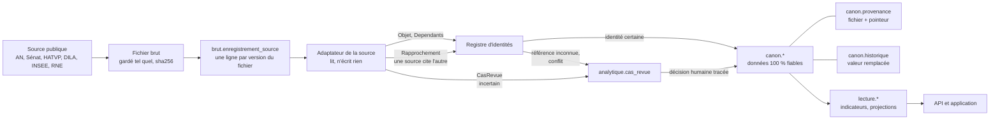

| Étape | Ce qui se passe | Code |
|---|---|---|
| Fichier brut | téléchargé, rangé sous son empreinte sha256, jamais modifié ; un fichier inchangé n'est pas relu | [charger()](../src/chargement.py#L80) |
| `brut.enregistrement_source` | une ligne par (système, fichier, membre de l'archive, empreinte) : une nouvelle version du fichier donne une nouvelle ligne, l'ancienne reste | [charger()](../src/chargement.py#L80) |
| Adaptateur | lit le fichier et produit des objets avec leur **identité native** (l'identifiant de la source) ; il ne touche pas à la base | `src/adaptateurs/sources/` |
| Registre d'identités | relie chaque identité native à une entité interne, seulement si c'est certain | [RegistreIdentites.identifier()](../src/identites.py#L47) |
| Écriture | colonnes écrites avec leur provenance ; une valeur connue remplacée part dans l'historique ; une référence vers un objet inconnu reste vide et devient un cas de revue | [ecrire()](../src/chargement.py#L115), [inconnue()](../src/chargement.py#L220) |
| Revue humaine | une personne tranche, la décision est tracée (qui, quand, pourquoi) puis appliquée | [decider()](../src/revue.py#L206), [appliquer()](../src/revue.py#L110) |

## 2. Le rapprochement : comment deux données sont reliées

Chaque objet garde **tous ses identifiants natifs** (celui de l'AN, celui du Sénat, celui de la
HATVP…), reliés à **une seule entité interne** par une correspondance qui dit comment le lien a été
établi et avec quelle preuve.

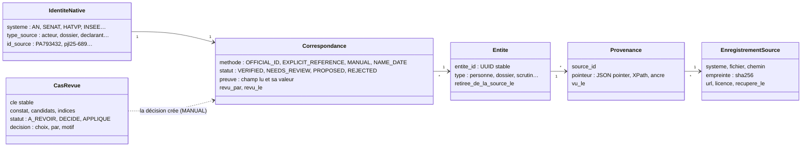

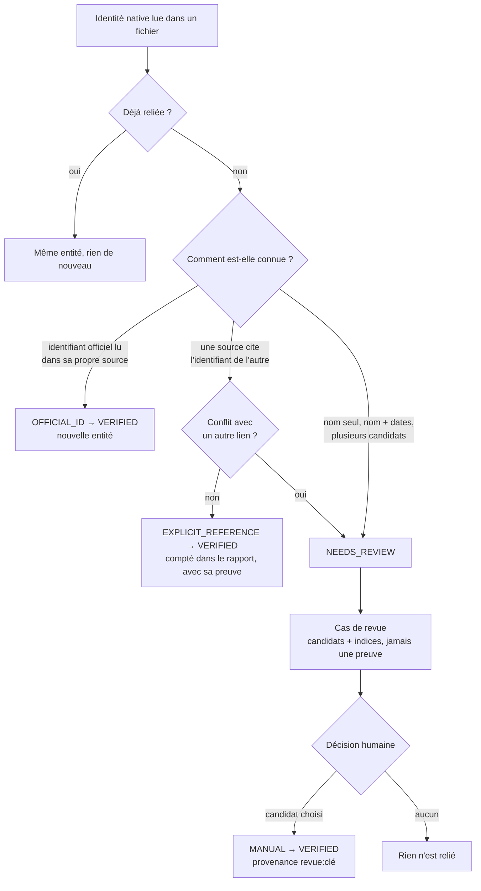

Code : [RegistreIdentites.identifier()](../src/identites.py#L47),
[RegistreIdentites.rapprocher()](../src/identites.py#L58), [signaler()](../src/revue.py#L91).

## 3. Schéma de la base

Quatre schémas : `brut` (ce qui a été reçu), `canon` (ce qui est certain), `analytique` (ce qui
ne l'est pas : cas de revue, affirmations à relire), `lecture` (indicateurs recalculés depuis
`canon`, voir [indicateurs.md](indicateurs.md)).

Toute entité (personne, dossier, scrutin…) a pour clé `entite_id`, qui est aussi une clé
étrangère vers `canon.entite`, la racine commune : ce lien n'est pas tracé, il vaut pour toutes.
Les faits sans identité propre (votes, liens, présences, avis) pointent vers
`enregistrement_source` par `source_id` : chacun sait de quel fichier il vient.

`}o--||` : obligatoire ; `}o--o|` : facultatif (le lien peut rester vide quand il n'est pas
certain).

### 3.1 Socle : traçabilité, identités, revue

<!-- uml:socle -->
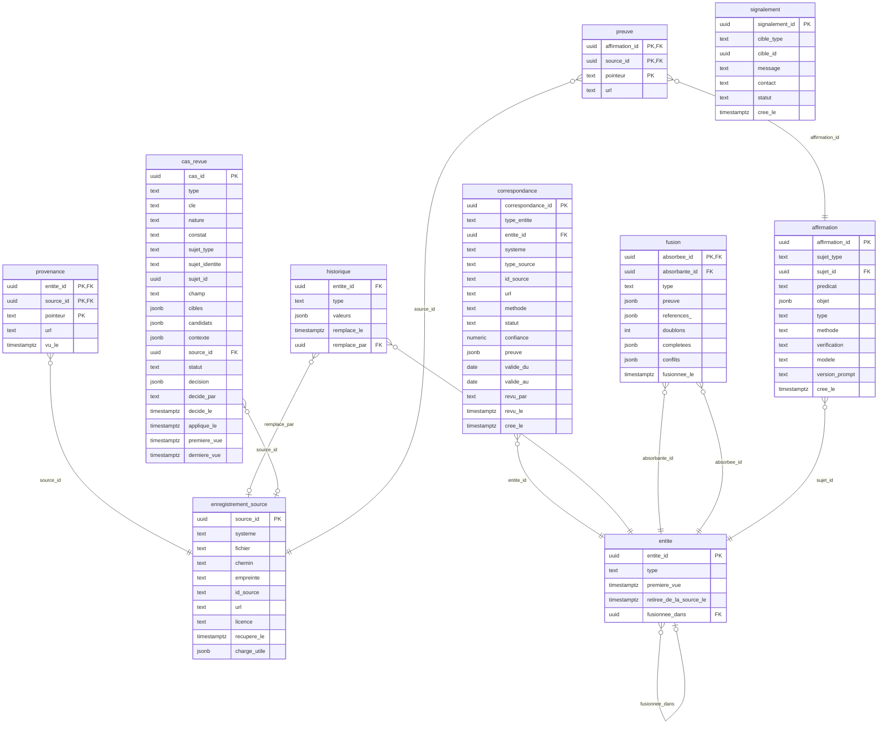
<!-- /uml -->

### 3.2 Personnes, organisations, fonctions

<!-- uml:personnes -->
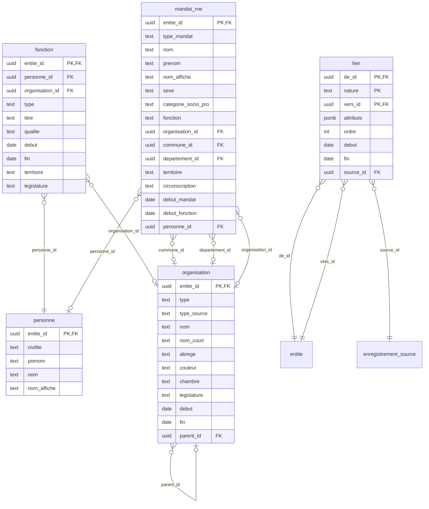
<!-- /uml -->

### 3.3 Dossiers, étapes, textes et articles

<!-- uml:dossiers -->
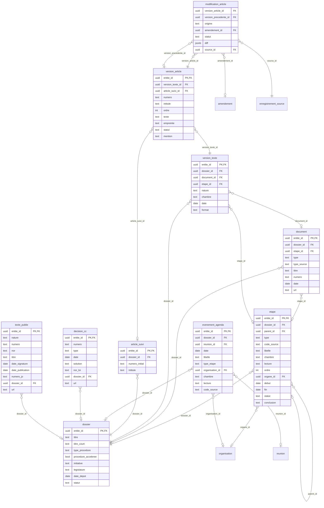
<!-- /uml -->

### 3.4 Amendements, scrutins, votes

<!-- uml:votes -->
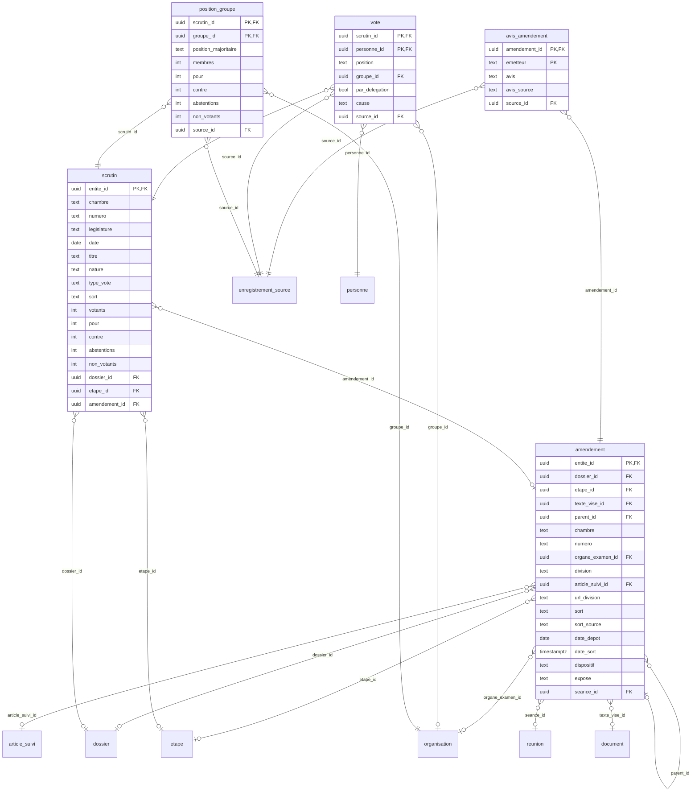
<!-- /uml -->

### 3.5 Réunions et interventions

<!-- uml:discussions -->
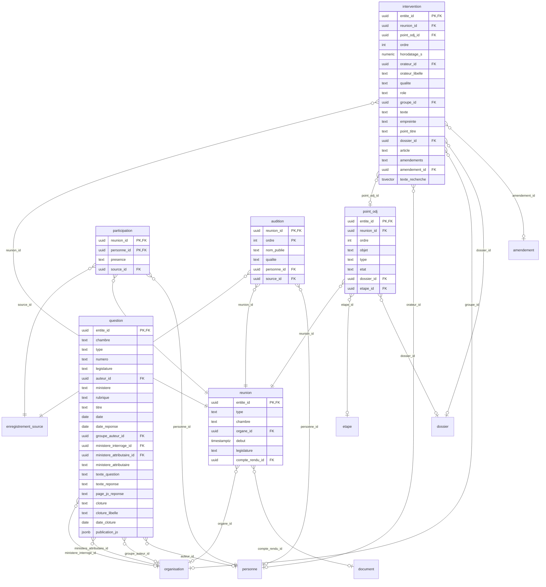
<!-- /uml -->

### 3.6 Transparence : déclarations et lobbying

<!-- uml:transparence -->
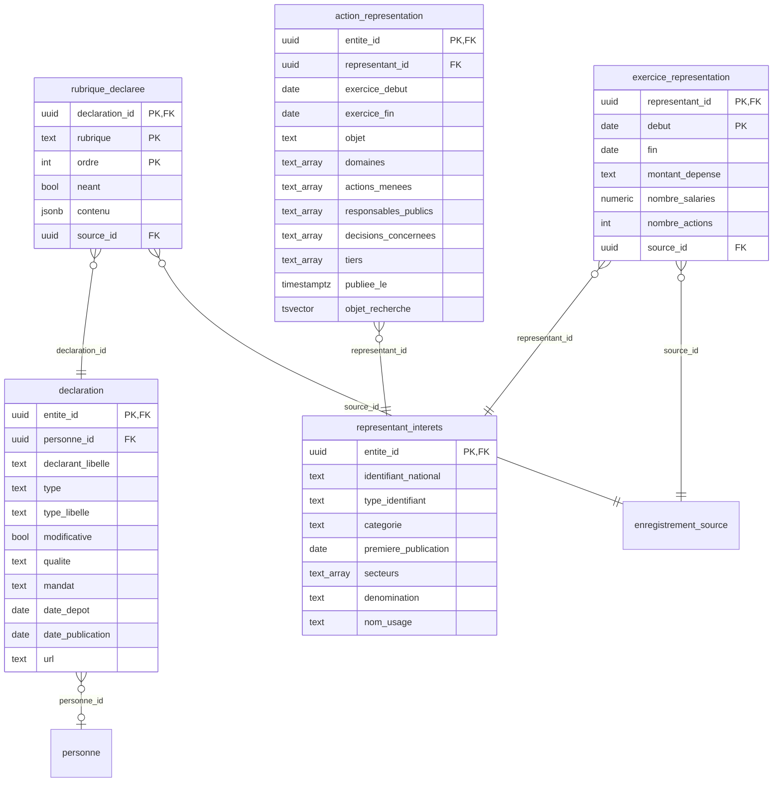
<!-- /uml -->

## 4. Des données brutes au canon, source par source

Dans chaque tableau : **champ source** tel que publié (chemin JSON, colonne CSV, balise XML),
**colonne** de destination, **règle** entre les deux. « tel quel » : aucune transformation.
L'identité native est entre crochets : `[AN:acteur:<uid>]`.

### 4.1 Assemblée nationale (data.assemblee-nationale.fr)

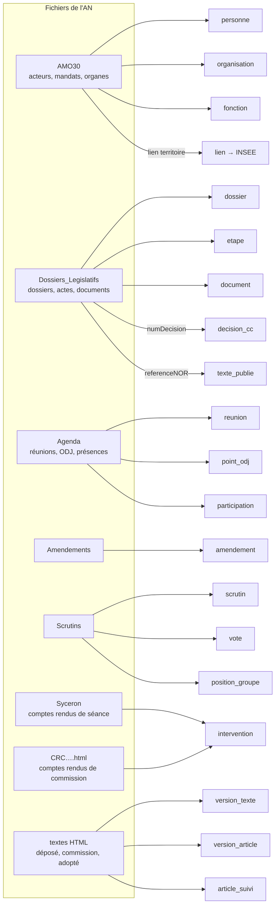

#### Personne `[AN:acteur:<uid>]` — `acteur/<PA>.json` › `acteur/etatCivil/ident`

| Champ source | Colonne `canon.personne` | Règle |
|---|---|---|
| `uid` | identité native | OFFICIAL_ID |
| `civ` | `civilite` | tel quel |
| `prenom` | `prenom` | tel quel |
| `nom` | `nom` | tel quel |
| `prenom` + `nom` | `nom_affiche` | concaténés |
| date et lieu de naissance | — | **jamais lus** |

Code : [acteur()](../src/adaptateurs/sources/an/acteurs.py#L82)

#### Fonction (mandat) `[AN:mandat:<uid>]` — `acteur/mandats/mandat[i]`

| Champ source | Colonne `canon.fonction` | Règle |
|---|---|---|
| `uid` (PM…) | identité native | OFFICIAL_ID |
| `acteur/uid` | `personne_id` | référence explicite |
| `organes/organeRef` | `organisation_id` | référence explicite, si l'organe est chargé |
| `typeOrgane` | `type` | table de correspondance (ASSEMBLEE → depute, GP → membre_groupe…) |
| `infosQualite/libQualiteSex`, `election/lieu` | `titre` | « Député, Essonne, 4e circonscription » ([titre()](../src/adaptateurs/sources/an/acteurs.py#L67)) |
| `infosQualite/libQualite` | `qualite` | tel quel |
| `mandature/datePriseFonction`, sinon `dateDebut` | `debut` | prise de fonction d'abord (un ministre réélu ne siège qu'après) |
| `dateFin` | `fin` | tel quel |
| `election/lieu/numDepartement` | `lien` (nature `territoire`) | code INSEE publié par l'AMO → `INSEE:departement:<code>`, attribut `circonscription` |
| groupes d'amitié et d'études (GA, GE, GEVI) | — | non chargés |

#### Organisation `[AN:organe:<uid>]` — `organe/<PO>.json`

| Champ source | Colonne `canon.organisation` | Règle |
|---|---|---|
| `codeType` | `type`, `type_source` | table de correspondance (GP → groupe_politique, COMPER → commission…) ; code gardé |
| `libelle` | `nom` | tel quel |
| `libelleAbrege`, `libelleAbrev` | `nom_court`, `abrege` | tels quels |
| `couleurAssociee` | `couleur` | tel quel |
| `viMoDe/dateDebut`, `dateFin` | `debut`, `fin` | tels quels |
| `organeParent` | `parent_id` | référence explicite |

Code : [organe()](../src/adaptateurs/sources/an/acteurs.py#L53)

#### Dossier `[AN:dossier:<uid>]` — `dossierParlementaire/<DLR…>.json`

| Champ source | Colonne `canon.dossier` | Règle |
|---|---|---|
| `titreDossier/titre` | `titre` | tel quel |
| `titreDossier/titreChemin` | `titre_court` | tel quel |
| `procedureParlementaire/libelle` | `type_procedure` | tel quel |
| un acte `ProcedureAccelere_Type` | `procedure_acceleree` | vrai s'il existe |
| `texteAssocie` de l'acte de dépôt | `initiative` | PRJL… → gouvernement ; PION…, PNRE… → parlementaire |
| `dateActe` des dépôts | `date_depot` | le plus ancien |
| `titreDossier/senatChemin` | identité `SENAT:dossier:<signet>` | **EXPLICIT_REFERENCE** : même dossier des deux côtés |
| `initiateur/acteurs`, `organes` | `lien` (nature `initiateur`) | références explicites |

Code : [dossier()](../src/adaptateurs/sources/an/dossiers.py#L96)

#### Étape `[AN:acte:<dossier>:<uid de l'acte>]` — `actesLegislatifs/acteLegislatif[…]`

| Champ source | Colonne `canon.etape` | Règle |
|---|---|---|
| position dans l'arbre | `parent_id`, `ordre` | arbre publié, ordre publié |
| `@xsi:type`, `codeActe` | `type`, `code_source` | type déduit de `@xsi:type` ([type_etape()](../src/adaptateurs/sources/an/dossiers.py#L48)) ; code gardé |
| `libelleActe/nomCanonique` | `libelle` | tel quel |
| préfixe du code racine (AN1, SN1, CMP…) | `chambre`, `lecture` | AN1 → AN, lecture 1 ; CMP → CMP… |
| `organeRef` | `organe_id` | référence explicite |
| `dateActe` | `debut` | tel quel |
| `statutConclusion/libelle` | `conclusion` | tel quel |
| `voteRefs`, `reunionRef`, `odjRef`, `texteAssocie`, `rapporteurs` | `lien` (scrutin, reunion, point_odj, texte, rapporteur) | références explicites, jamais par le titre |
| `numDecision` + `anneeDecision` | `decision_cc` `[CONSTIT:decision:<année>-<n°>]` | même numéro que le stock CONSTIT |
| `infoJO/referenceNOR`, `codeLoi`, `dateJO`, `numJO` | `texte_publie` `[LEGIFRANCE:nor:<NOR>]` | référence explicite |

Code : [actes()](../src/adaptateurs/sources/an/dossiers.py#L64)

#### Document `[AN:document:<uid>]` — `document/<uid>.json`

| Champ source | Colonne `canon.document` | Règle |
|---|---|---|
| `dossierRef` | `dossier_id` | référence explicite |
| `classification/type/code` | `type`, `type_source` | PRJL → projet, RAPP → rapport, TADO → texte_adopte… ; code et sous-type gardés |
| `titres/titrePrincipal` | `titre` | tel quel |
| `notice/numNotice` | `numero` | tel quel |
| `cycleDeVie/chrono/dateDepot` | `date` | tel quel |
| `auteurs`, `coSignataires` | `lien` (auteur, cosignataire) | références explicites |

Code : [document()](../src/adaptateurs/sources/an/dossiers.py#L164)

#### Réunion, ordre du jour, présences `[AN:reunion:<uid>]` — `reunion/<RU…>.json`

| Champ source | Colonne | Règle |
|---|---|---|
| `@xsi:type` | `reunion.type` | seance_type → seance ; reunionCommission_type → commission |
| `organeReuniRef` | `reunion.organe_id` | référence explicite |
| `timeStampDebut` | `reunion.debut` | tel quel |
| `compteRenduRef` | `reunion.compte_rendu_id` | référence explicite |
| `ODJ/pointsODJ/pointODJ[i]` : `objet`, `typePointODJ`, `cycleDeVie/etat` | `point_odj.objet`, `type`, `etat` | tels quels |
| `dossiersLegislatifsRefs` | `point_odj.dossier_id` ou `lien` | un seul dossier : direct ; plusieurs : un lien vers chacun |
| `participants/participantInterne` : `acteurRef`, `presence` | `participation.personne_id`, `presence` | présent, absent, excusé |

Code : [reunion()](../src/adaptateurs/sources/an/agenda.py#L20)

#### Amendement `[AN:amendement:<uid>]` — `json/<dossier>/<texte>/<uid>.json`

| Champ source | Colonne `canon.amendement` | Règle |
|---|---|---|
| chemin dans l'archive `json/<dossier>/` | `dossier_id` | référence explicite |
| `texteLegislatifRef` | `texte_vise_id` | référence explicite |
| `amendementParentRef` | `parent_id` | sous-amendement |
| `identification/numeroLong` | `numero` | tel quel |
| `PO…` dans l'uid | `organe_examen_id` | lu dans l'identifiant officiel |
| `pointeurFragmentTexte/division` | `division`, `url_division` | tels quels |
| `cycleDeVie/sort`, sinon `etatDesTraitements/etat` | `sort`, `sort_source` | Adopté → adopte… ; sans sort : Irrecevable, Retiré, sinon en_attente ; libellé gardé ([sort()](../src/adaptateurs/sources/an/amendements.py#L28)) |
| `cycleDeVie/dateDepot`, `dateSort` | `date_depot`, `date_sort` | tels quels |
| `corps/contenuAuteur/dispositif`, `exposeSommaire` | `dispositif`, `expose` | HTML tel que publié |
| `seanceDiscussionRef` | `seance_id` | référence explicite |
| `signataires/auteur`, `cosignataires`, `groupePolitiqueRef` | `lien` (auteur, cosignataire, groupe_auteur) | références explicites |
| avis du rapporteur et du Gouvernement | `avis_amendement` | **non publiés** par l'AN en données structurées : vide |

Code : [amendement()](../src/adaptateurs/sources/an/amendements.py#L112)

#### Scrutin, votes, positions de groupe `[AN:scrutin:<uid>]` — `json/<VT…>.json`

| Champ source | Colonne | Règle |
|---|---|---|
| `numero`, `dateScrutin`, `titre` | `scrutin.numero`, `date`, `titre` | tels quels |
| `typeVote/codeTypeVote`, `titre` | `scrutin.nature` | MOC → motion_censure ; sinon lu dans le titre (« l'ensemble », « l'amendement n° »…) : un libellé, pas un lien ([nature()](../src/adaptateurs/sources/an/scrutins.py#L39)) |
| `typeVote/libelleTypeVote`, `sort/code` | `type_vote`, `sort` | tels quels |
| `syntheseVote/nombreVotants`, `decompte/*` | `votants`, `pour`, `contre`, `abstentions`, `non_votants` | tels quels |
| acte du dossier qui cite le scrutin (`voteRefs`), sinon `objet/dossierLegislatif` | `dossier_id`, `etape_id` | références explicites, jamais par le titre |
| numéro cité par le titre + `seanceRef` | `amendement_id` | l'amendement de ce numéro discuté dans cette séance ; ambigu ou introuvable → **revue** |
| `decompteNominatif` : `acteurRef`, `parDelegation`, `causePositionVote` | `vote.personne_id`, `position`, `par_delegation`, `cause` | pours → pour, nonVotants → non_votant… |
| `groupe/organeRef`, `nombreMembresGroupe`, `decompteVoix` | `position_groupe.*` | tels quels |
| `positionMajoritaire` | `position_groupe.position_majoritaire` | **recalculée** depuis le décompte (la valeur publiée est parfois fausse) ([majoritaire()](../src/adaptateurs/sources/an/scrutins.py#L58)) |

Code : [scrutin()](../src/adaptateurs/sources/an/scrutins.py#L78)

#### Intervention en séance `[AN:intervention:<compte rendu>#<id_syceron>]` — Syceron XML

| Champ source | Colonne `canon.intervention` | Règle |
|---|---|---|
| paragraphes consécutifs d'un même `@id_acteur` | une intervention, `ordre` | un tour de parole |
| `@id_acteur` = PA… | `orateur_id` | OFFICIAL_ID ; PA0 (voix collective) : aucun ; PA-… : **revue** |
| `orateurs/orateur/nom`, `qualite` | `orateur_libelle`, `qualite` | tels quels |
| `@code_grammaire` | `role` | tel quel |
| `texte` des paragraphes | `texte`, `empreinte` | tel quel ; sha256 du texte |
| `texte/@stime` | `horodatage_s` | secondes depuis l'ouverture |
| titre du point de niveau 1 | `point_titre` | tel quel |
| `point/@valeur` « (n° 2406, 2401) » | `dossier_id` ou `lien` | numéros de texte → documents principaux → dossier ; plusieurs : un lien chacun |
| `@art` | `article` | tel quel |
| `@adt` | `amendements`, `amendement_id` ou `lien` | numéros gardés ; retrouvés dans la séance ; ambigu ou introuvable → **revue** |

Code : [seance()](../src/adaptateurs/sources/an/seances.py#L55), [Tour](../src/adaptateurs/sources/an/seances.py#L41)

#### Intervention en commission `[AN:intervention:<CRC…>#<ordre>]` — HTML

| Élément HTML | Colonne `canon.intervention` | Règle |
|---|---|---|
| paragraphe ouvert par un passage en gras terminé par un point | `orateur_libelle`, `qualite`, `role` = parole | « M. X, rapporteur. » → (M. X, rapporteur) ([orateur()](../src/adaptateurs/sources/an/commissions.py#L90)) |
| nom de l'orateur | `orateur_id` | **jamais automatique** : cas de revue, candidats parmi les présents de la réunion |
| paragraphe entièrement en gras | `role` = intitule, `article` | « Article 1er : … » fixe l'article discuté |
| paragraphe en italique | `role` = didascalie, `amendements` | « Amendements AS2… » ; « (n° 4) » fixe le texte examiné |
| numéro de texte cité | `dossier_id` ou `lien` | à partir de l'endroit où il est cité ; pas de repli sur l'agenda |
| (organe, texte, numéro d'amendement) | `amendement_id` | un seul candidat : relié ; sinon **revue** |

Code : [compte_rendu()](../src/adaptateurs/sources/an/commissions.py#L97)

#### Textes et articles `[AN:version_texte:<uid>]`, `[AN:article:<uid>#<numéro>]` — HTML

| Élément source | Colonne | Règle |
|---|---|---|
| préfixe de l'uid `B`, `BTC`, `BTA` | `version_texte.nature` | déposé, commission, adopté |
| `cycleDeVie/chrono/dateDepot` | `version_texte.date` | tel quel |
| paragraphe `assnat9ArticleNum` | `version_article.numero`, `intitule`, `mention`, `ordre` | « Article 2 bis (nouveau) » ([articles()](../src/adaptateurs/sources/an/textes.py#L59)) |
| paragraphes suivants | `version_article.texte`, `empreinte` | jusqu'à l'article suivant ; sha256 |
| mention « (Supprimé) », « (Conforme) » | `version_article.statut` | supprime, conforme, present… |
| clé du dossier Sénat si l'AN la cite, sinon du dossier AN + numéro | `article_suivi` `[CIVICTRACE:article_suivi:<dossier>#<n°>]` | même article des deux côtés de la navette ([article_suivi()](../src/textes.py#L88)) |
| texte sans balise d'article, plage « Articles 3 à 5 » | — | **revue** (constat), aucun suivi supposé |

Code : [version()](../src/adaptateurs/sources/an/textes.py#L90)

### 4.2 Sénat (data.senat.fr)

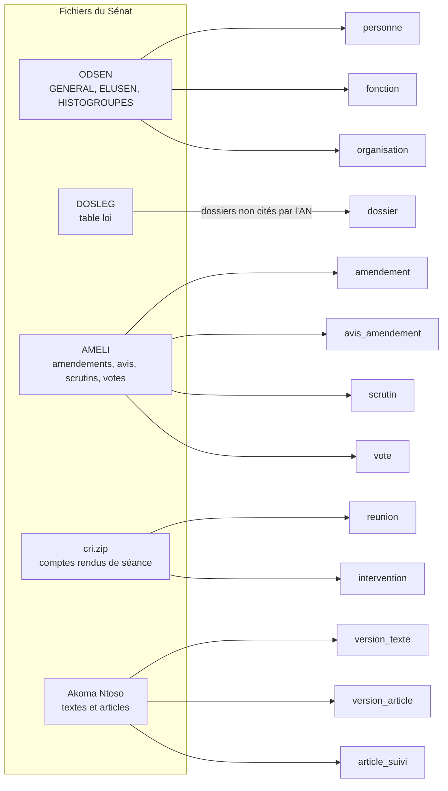

| Source › champ | Colonne | Règle |
|---|---|---|
| ODSEN_GENERAL › `Matricule` | `personne` `[SENAT:senateur:<matricule>]` | OFFICIAL_ID |
| › `Qualité`, `Prénom usuel`, `Nom usuel` | `civilite`, `prenom`, `nom`, `nom_affiche` | tels quels ; date de naissance et e-mail jamais lus ([senateur()](../src/adaptateurs/sources/senat/senateurs.py#L31)) |
| ODSEN_ELUSEN › `Identifiant mandat`, dates, `Motif début de mandat` | `fonction` (senateur) : `debut`, `fin`, `qualite` | tels quels ([mandat()](../src/adaptateurs/sources/senat/senateurs.py#L40)) |
| ODSEN_HISTOGROUPES › `Code du groupe politique`, `Nom court…` | `organisation` (groupe) | nom de la période la plus récente ([groupe()](../src/adaptateurs/sources/senat/senateurs.py#L50)) |
| › `Id fonction occupée`, `Nom court fonction`, dates | `fonction` (membre_groupe) | une fonction par période (membre, puis président…) ([appartenance()](../src/adaptateurs/sources/senat/senateurs.py#L67)) |
| DOSLEG `loi` › `signet` | `dossier` `[SENAT:dossier:<signet>]` | déjà relié par l'AN : **rien n'est réécrit** (pas deux sources pour un même champ) |
| › `loient` + `loitit`, `motclef`, `proaccdat` | `titre`, `titre_court`, `procedure_acceleree` | concaténés ; présence de la date ([dossier()](../src/adaptateurs/sources/senat/dossiers.py#L15)) |
| AMELI `amd` › `id`, `num`, `datdep` | `amendement` `[SENAT:amendement:<id>]` : `numero`, `date_depot` | tels quels |
| › `txtid` → `txt_ameli.doslegsignet` | `dossier_id` | référence explicite |
| › `subid`, `sorid` | `division`, `sort`, `sort_source` | libellés des tables de référence AMELI |
| › `dis`, `obj` | `dispositif`, `expose` | HTML nettoyé |
| › `avcid`, `avgid` | `avis_amendement` (commission, gouvernement) | F → favorable, D → defavorable, S → sagesse… |
| `amdsen` › `senid`, `rng` | `lien` (auteur = rang 1, cosignataires) | matricule par référence explicite ([amendement()](../src/adaptateurs/sources/senat/travaux.py#L146)) |
| AMELI `scr` › `sesann`, `scrnum`, `scrdat`, `scrint`, `scrvot`, `scrpou`, `scrcon` | `scrutin` `[SENAT:scrutin:<session>-<n°>]` | tels quels ; nature lue dans l'intitulé |
| › `code` → séance → lecture → `loi.signet` | `scrutin.dossier_id` | chaîne de références explicites |
| `amescr` | `scrutin.amendement_id` | un seul amendement de ce numéro dans le dossier ; sinon **revue** ([scrutin()](../src/adaptateurs/sources/senat/travaux.py#L185)) |
| `votsen` › `senmat`, `posvotcod`, `senmatdel`, `stavotidt` | `vote.personne_id`, `position`, `par_delegation`, `cause` | 1 → pour, 2 → contre, 3 → abstention, 4 → non_votant |
| cri.zip › `d<AAAAMMJJ>.xml` | `reunion` `[SENAT:seance:d<date>]`, `document` (compte rendu) | un jour de séance |
| › `@mat` + `type` 1 | `intervention.orateur_id` | matricule du sénateur : OFFICIAL_ID |
| › `@mat` + `type` 2 (Gouvernement) | `intervention.orateur_id` | matricule Sénat ; lien avec l'acteur AN : **revue** ([membre_du_gouvernement()](../src/adaptateurs/sources/senat/debats.py#L177)) |
| › `qua`, texte, section `sect_pdl` + `signet`, `num` | `qualite`, `texte`, `empreinte`, `point_titre`, `dossier_id`, `article` | tels quels ; dossier par le signet de la section ([seance()](../src/adaptateurs/sources/senat/debats.py#L115)) |
| Akoma Ntoso › `FRBRdate`, articles `eId`, `num`, `heading` | `version_texte`, `version_article`, `article_suivi` | même règle de suivi que l'AN ([version()](../src/adaptateurs/sources/senat/textes.py#L84)) |

### 4.3 HATVP (hatvp.fr)

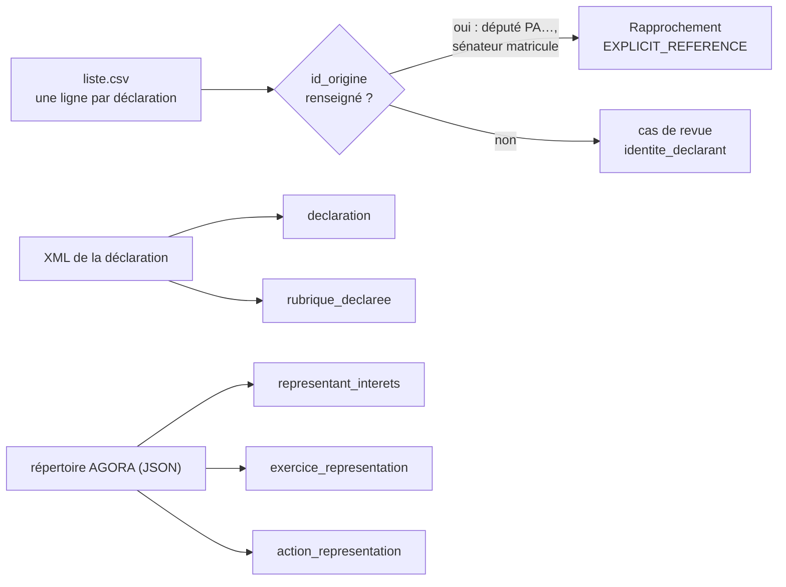

| Source › champ | Colonne | Règle |
|---|---|---|
| liste.csv › `url_dossier` | identité `[HATVP:declarant:<dossier>]` | dernier segment de l'URL ([declarant()](../src/adaptateurs/sources/hatvp/declarations.py#L69)) |
| › `id_origine` + `type_mandat` | identité AN `PA<id_origine>` ou Sénat `<matricule>` | **EXPLICIT_REFERENCE** ; vide → revue, candidats par nom, jamais reliés seuls |
| › `type_document`, `qualite`, `type_mandat`, `date_depot`, `date_publication`, `nom_fichier` | `declaration.type`, `qualite`, `mandat`, `date_depot`, `date_publication`, `url` | tels quels |
| XML › `uuid` | `declaration` `[HATVP:declaration:<uuid>]` | OFFICIAL_ID |
| › `general/typeDeclaration/label`, `declarationModificative` | `type_libelle`, `modificative` | tels quels |
| › chaque rubrique | `rubrique_declaree.rubrique`, `neant`, `contenu` | telle que publiée ; adresses, téléphones, e-mails, dates de naissance **retirés à la lecture** ([declaration()](../src/adaptateurs/sources/hatvp/declarations.py#L73)) |
| AGORA › `typeIdentifiantNational` + `identifiantNational` | `representant_interets` `[HATVP:representant:<type>:<id>]` | SIREN, RNA ou HATVP |
| › `denomination`, `nomUsage`, `categorieOrganisation`, `datePremierePublication`, secteurs | `denomination`, `nom_usage`, `categorie`, `premiere_publication`, `secteurs` | tels quels |
| › exercices : dates, `montantDepense`, `nombreSalaries`, `nombreActivite` | `exercice_representation.*` | tels quels |
| › activités : `identifiantFiche`, `objet`, domaines, actions, responsables publics, décisions | `action_representation.*` | tels quels ; lien vers un texte de loi : **jamais supposé** ([representant()](../src/adaptateurs/sources/hatvp/representants.py#L41)) |

### 4.4 Conseil constitutionnel (DILA, stock CONSTIT)

| Champ source (XML) | Colonne `canon.decision_cc` | Règle |
|---|---|---|
| `META_JURI/NUMERO` | identité `[CONSTIT:decision:<numéro>]`, `numero` | OFFICIAL_ID ; même numéro que celui cité par l'AN |
| `META_COMMUN/NATURE` | `type` | tel quel |
| `META_JURI/DATE_DEC` | `date` | tel quel |
| `META_JURI/SOLUTION` | `solution` | tel quel (« Conformité », « Non conformité partielle »…) |
| `META_JURI_CONSTIT/LOI_DEF@nor` | `nor_loi` | NOR de la loi contrôlée ; « SUPPRIME » ignoré |
| `META_JURI_CONSTIT/URL_CC` | `url` | tel quel |

Code : [analyser()](../src/adaptateurs/sources/constit/__init__.py#L44)

### 4.5 INSEE (Code officiel géographique 2026)

| Fichier › champ | Colonne `canon.organisation` | Règle |
|---|---|---|
| `v_region` › `REG`, `LIBELLE` | `[INSEE:region:<REG>]` : `nom`, `abrege` | tels quels ([region()](../src/adaptateurs/sources/insee/__init__.py#L36)) |
| `v_departement` › `DEP`, `LIBELLE`, `REG` | `[INSEE:departement:<DEP>]` : `nom`, `parent_id` → région | code officiel ([departement()](../src/adaptateurs/sources/insee/__init__.py#L42)) |
| `v_comer` › `COMER`, `LIBELLE` | `[INSEE:collectivite_outre_mer:<COMER>]` | tels quels ([outre_mer()](../src/adaptateurs/sources/insee/__init__.py#L49)) |
| `v_commune` › `COM`, `TYPECOM`, `LIBELLE`, parent | `[INSEE:<type>:<COM>]` | le type fait partie de l'identité (une commune déléguée peut porter le code de sa commune nouvelle) ([commune()](../src/adaptateurs/sources/insee/__init__.py#L56)) |

Tous les liens vers un territoire passent par ces codes, jamais par un nom.

### 4.6 Répertoire national des élus (RNE)

Le RNE ne publie **aucun identifiant de personne** : chaque ligne devient une fiche
`mandat_rne`, et le lien vers une personne ne se fait **que par la revue humaine**.

| Champ source (CSV) | Colonne `canon.mandat_rne` | Règle |
|---|---|---|
| siège + date (maire : commune + début de fonction ; député : circonscription + début de mandat ; autres : + nom) | identité `[RNE:mandat:<clé>]` | clé locale, pas un identifiant de personne ([cle()](../src/adaptateurs/sources/rne/__init__.py#L87)) |
| `Nom de l'élu`, `Prénom de l'élu` | `nom`, `prenom`, `nom_affiche` | tels quels |
| `Code sexe`, `Libellé de la catégorie socio-professionnelle` | `sexe`, `categorie_socio_pro` | tels quels |
| `Libellé de la fonction` | `fonction` | tel quel ; « Maire » pour le fichier des maires |
| `Code de la commune`, `N° SIREN`, `Code du département` | `organisation_id`, `commune_id`, `departement_id` | codes INSEE et SIREN ; communes d'outre-mer hors COG : vides |
| `Date de début du mandat`, `…de la fonction` | `debut_mandat`, `debut_fonction` | tels quels |
| — | `personne_id` | **posé par la revue seulement** (cas `elu_local`) |
| `Date de naissance` | — | **jamais lue** |

Code : [valeurs()](../src/adaptateurs/sources/rne/__init__.py#L112), [mandat()](../src/adaptateurs/sources/rne/__init__.py#L163),
[epci()](../src/adaptateurs/sources/rne/__init__.py#L186)
